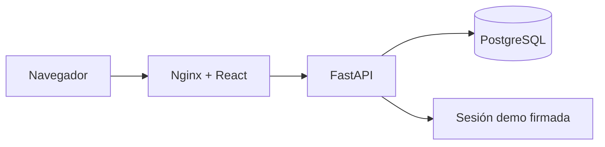

# Arquitectura

Monorepositorio con frontend React/TypeScript (Vite), API FastAPI síncrona con SQLAlchemy y PostgreSQL 16. Nginx sirve los archivos compilados y envía `/api` al backend bajo el mismo origen. Alembic aplica las migraciones antes del inicio de Uvicorn.

Los módulos del backend separan rutas HTTP, schemas, modelos y servicios de negocio. Las rutas controlan la transacción; los servicios reutilizables no hacen commits. Importación y formularios usan las mismas validaciones. La base impone restricciones de unicidad, claves foráneas y checks como segunda barrera.

La identidad es el nombre declarado en una cookie firmada HttpOnly. La contraseña solo se comprueba como no vacía y se descarta. No existen roles ni permisos por área. Los campos de auditoría se toman de la sesión en el backend.

`multas` tiene un UUID y un código único; `pagos` tiene UUID, comprobante único y clave foránea compuesta `(codigo_multa,dni_infractor)`. El estado de cobranza es calculado a partir de pagos no anulados. Bajas y anulaciones son lógicas y dejan historial.

`importaciones` y `filas_importacion` contienen los borradores, apartados de las tablas definitivas. La confirmación bloquea el lote, vuelve a validar, bloquea las multas necesarias y guarda todo dentro de una transacción. La marca `CONFIRMADA` se confirma junto con los registros: consultar el lote resuelve un resultado incierto después de un fallo de conexión.

El bloqueo de la multa serializa cambios de monto, pagos y anulaciones para impedir sobrepagos concurrentes. Los índices sirven a búsquedas por DNI, fechas, códigos y relaciones de pagos. No se persiste `estado_multa`, por lo que no puede quedar desactualizado respecto a los pagos.

No se requieren colas, Redis ni servicios externos. Los borradores se limpian al acceder al módulo cuando pasan 24 horas; no hay trabajador de tareas en segundo plano. Los recursos Docker y la base de pruebas tienen nombres propios.
